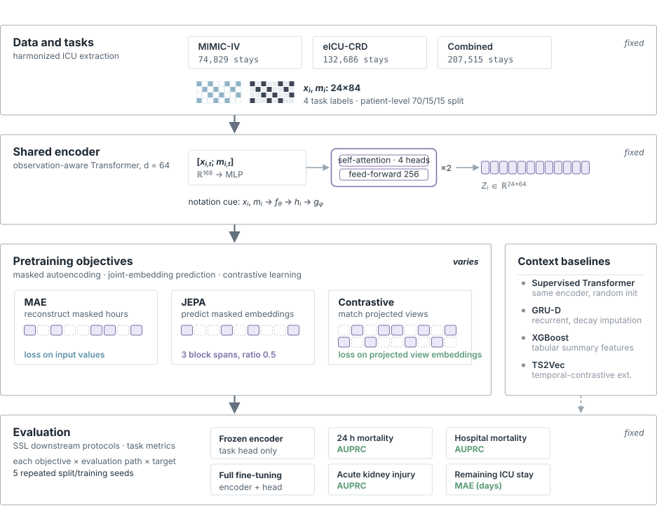
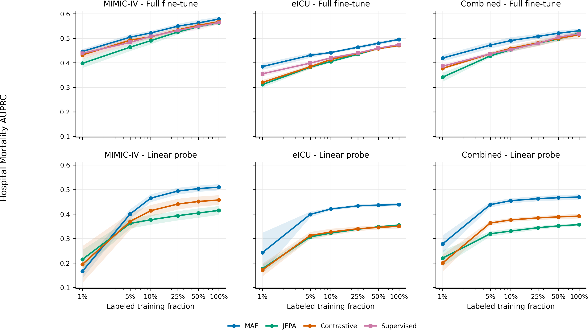

# SLICES: Self-Supervised Learning for Intensive Care Embeddings

<p align="center">
  
</p>

<p align="center">
  
  
  
  
</p>

<p align="center">
  <code>ICU time series</code> <code>self-supervised learning</code> <code>clinical AI</code> <code>PyTorch Lightning</code> <code>RICU</code> <code>Hydra</code>
</p>

**SLICES** is a benchmark and PyTorch codebase for comparing self-supervised
learning objectives on sparse, irregular ICU time series.

The core question is narrow by design: when the data pipeline, encoder,
tokenization, epoch/data-pass schedule, and downstream protocols are held fixed,
how do **MAE**, **JEPA**, and **contrastive learning** differ?

<p align="center">
  
</p>

## Status

- Master's thesis benchmark code is public. The benchmark is also described in
  an ML4H 2026 proceedings paper; see [Citation](#citation).
- The frozen thesis metric export is bundled at
  `results/slices-thesis-v1/`, with three diagnostic packages next to it.
  `uv run python scripts/audit_results.py` verifies all of them.
- Patient data and trained weights are not included. Reproduction requires
  credentialed MIMIC-IV and eICU access.
- Provenance: all results come from W&B project `hannes-ill/slices-final`
  (private), revision `thesis-v1`, launched from the code state tagged
  `thesis-v1-launch`. See [Provenance](#provenance).

## What Is Included

| Area | Scope |
|---|---|
| Data pipeline | RICU extraction, hourly ICU tensors, observation masks, train-only normalization |
| Core SSL objectives | MAE, JEPA, contrastive |
| Extension objective | TS2Vec temporal contrastive learning |
| External reference | SMART/MART implementation, optional and outside the controlled thesis corpus |
| Encoders | Observation-aware Transformer, GRU-D, linear; SMART/MART as optional reference code |
| Downstream tasks | 24h mortality, hospital mortality, AKI KDIGO, remaining LOS |
| Protocols | Linear probing and full fine-tuning |
| Baselines | Supervised Transformer, GRU-D, XGBoost |
| Evaluation | AUROC, AUPRC, calibration, regression metrics, fairness summaries, paired tests |

SLICES is not a clinical deployment model, a public patient-data release, or a
replacement for broad ICU benchmarks such as YAIB. It is focused on objective
comparison under a shared sparse-clinical-time-series interface.

## Result Snapshot

These claims are from the bundled frozen thesis export
`results/slices-thesis-v1/`. The historical source was W&B
`hannes-ill/slices-final`, revision `thesis-v1`.

- In the core SSL benchmark, MAE is the best or tied-best SSL method on most
  classification comparisons, especially under linear probing.
- MAE has the highest five-seed mean AUPRC among MAE, JEPA, and contrastive in
  all nine linear-probe classification cells (3 datasets x 3 tasks). Full
  fine-tuning compresses the observed differences and makes the supervised
  Transformer a stronger comparator.
- All method comparisons are descriptive. Five matched training seeds give an
  exact two-sided paired-test floor of `p=0.0625` per task. The
  `omnibus_primary_metric` rows in `statistical_tests.parquet` pool tasks that
  share cohorts, splits, and pretrained encoders, so their smaller p-values are
  not independent evidence; read them as descriptive summaries.
- LOS behaves differently from classification: under the frozen linear probe,
  contrastive has the lowest `test/mae` on all three datasets. That probe trains
  with squared error but is scored on absolute error, and loss-matched probes
  shrink the differences, so do not read this as a robust LOS ranking.
- Across the label-fraction grid, including full labels, MAE has the best mean
  primary metric in `35/45` full-finetune cells (against JEPA, contrastive, and
  the supervised Transformer) and `37/45` linear-probe cells (against JEPA and
  contrastive).

<p align="center">
  
</p>

## Install

Prerequisites:

- Python 3.12+
- [uv](https://github.com/astral-sh/uv)
- R with access to the source ICU datasets for extraction

```bash
git clone https://github.com/hannesill/SLICES.git
cd SLICES
uv sync --dev
```

Smoke test:

```bash
uv run python -c "from slices.models.pretraining import MAEObjective, JEPAObjective, ContrastiveObjective; print('OK')"
```

Verify the bundled result packages (no data, W&B, or weights needed):

```bash
uv run python scripts/audit_results.py
```

## Quick Start

### 1. Build Processed Data

The thesis corpus used MIMIC-IV v2.2, eICU-CRD v2.0, and RICU 0.6.3. Install
`ricu` 0.6.3 in R yourself: the extraction script installs the latest CRAN
version only if `ricu` is missing.

Run the RICU extraction once per credentialed source dataset. Point
`--raw_data_dir` at the PhysioNet CSV files (defaults: `data/raw/mimiciv`,
`data/raw/eicu-crd`):

```bash
Rscript scripts/preprocessing/extract_with_ricu.R --dataset miiv \
  --raw_data_dir /path/to/mimic-iv-2.2 --output_dir data/ricu_output/miiv
Rscript scripts/preprocessing/extract_with_ricu.R --dataset eicu \
  --raw_data_dir /path/to/eicu-crd-2.0 --output_dir data/ricu_output/eicu
```

The thesis extraction used the default 72-hour raw export horizon; labels need
at least 48 hours. `scripts/setup_and_extract.sh` runs dependency setup,
extraction, and preprocessing in one go on Debian-like hosts.

Convert RICU output into SLICES tensors:

```bash
uv run python scripts/preprocessing/build_processed_data.py --datasets miiv eicu --combined
```

This creates `data/processed/{miiv,eicu,combined}` with:

- `static.parquet`
- `timeseries.parquet`
- `labels.parquet`
- `metadata.yaml`
- `splits.yaml`
- `normalization_stats.yaml`

Check the cohort against the thesis corpus: `metadata.yaml` should report
`n_stays` of 74,829 (MIMIC-IV), 132,686 (eICU), and 207,515 (combined), with
84 features.

### 2. Pretrain an SSL Encoder

Pick the objective with `ssl=`. Disable W&B for local smoke runs unless you have
configured an entity.

```bash
# MAE
uv run python scripts/training/pretrain.py dataset=miiv ssl=mae logging.use_wandb=false

# JEPA
uv run python scripts/training/pretrain.py dataset=miiv ssl=jepa logging.use_wandb=false

# Contrastive
uv run python scripts/training/pretrain.py dataset=miiv ssl=contrastive logging.use_wandb=false
```

### 3. Fine-Tune

```bash
# Linear probe
uv run python scripts/training/finetune.py \
  dataset=miiv \
  checkpoint=outputs/2026-07-01/12-00-00/encoder.pt \
  protocol=linear_probe \
  logging.use_wandb=false

# Full fine-tuning
uv run python scripts/training/finetune.py \
  dataset=miiv \
  checkpoint=outputs/2026-07-01/12-00-00/encoder.pt \
  protocol=full_finetune \
  logging.use_wandb=false
```

Switch tasks with `tasks=mortality_hospital`, `tasks=aki_kdigo`, or
`tasks=los_remaining`.

### 4. Run Baselines

```bash
# Supervised Transformer
uv run python scripts/training/supervised.py dataset=miiv logging.use_wandb=false

# GRU-D
uv run python scripts/training/supervised.py --config-name gru_d dataset=miiv logging.use_wandb=false

# XGBoost
uv run python scripts/training/xgboost_baseline.py dataset=miiv logging.use_wandb=false
```

### 5. Validate

```bash
uv run pytest -q
uv run ruff check src scripts tests
uv run mypy src
uv run python scripts/audit_results.py
```

## Configuration

SLICES uses Hydra. Main config groups:

| Group | Options |
|---|---|
| `ssl/` | `mae`, `jepa`, `contrastive`, `ts2vec`, `smart` (needs `model=smart`) |
| `model/` | `transformer`, `transformer_medium`, `transformer_large`, `gru_d`, `smart`, `linear`; `observation_transformer` is a legacy alternate tokenization |
| `tasks/` | `mortality_24h`, `mortality_hospital`, `aki_kdigo`, `los_remaining`; `mortality` (ICU mortality) is optional |
| `protocol/` | `linear_probe`, `full_finetune` |
| `data/` | `ricu` |

`dataset` is a plain key (`miiv`, `eicu`, `combined`), not a config group.
Top-level configs: `pretrain`, `finetune`, `supervised`, `gru_d`, `xgboost`,
`evaluate_imputation`, and `debug`. Fixed benchmark invariants live in
`src/slices/constants.py`, not in Hydra.

Examples:

```bash
# Change objective
uv run python scripts/training/pretrain.py dataset=eicu ssl=jepa

# Override objective hyperparameters
uv run python scripts/training/pretrain.py dataset=miiv ssl=jepa ssl.mask_ratio=0.75

# Inspect the resolved config
uv run python scripts/training/pretrain.py dataset=miiv ssl=mae --cfg job
```

## Benchmark Contract

The controlled comparison fixes:

- RICU-derived preprocessing
- 24h observation window
- patient-level 70/15/15 splits, drawn per seed (each of the five seeds
  `42, 123, 456, 789, 1011` has its own split and normalization statistics)
- train-only normalization
- normalize-then-zero-fill imputation
- separate observation masks
- observation-aware Transformer encoder
- downstream tasks and primary metrics
- five-seed evaluation where present

MAE, JEPA, and contrastive learning share the encoder interface and masking
budget. They do not use identical mask geometry: MAE uses random timestep masks,
JEPA uses block timestep masks, and contrastive learning uses two masked views.

Full thesis reruns and export rules are documented in
[docs/experiment_protocol.md](docs/experiment_protocol.md).
Public audit paths are documented in [REPRODUCIBILITY.md](REPRODUCIBILITY.md).

## Provenance

- Every row in `results/slices-thesis-v1/run_configs.parquet` carries its W&B
  run ID and URL, revision, seed, launch commit, and full resolved config.
  Evaluation and fairness artifacts carry SHA256 hashes.
- The W&B project `hannes-ill/slices-final` is private, so run URLs are
  provenance identifiers, not public links.
- All 2,310 exported runs record launch commit
  `ffd6dc52c2ed224da5290cfb5d1a6634b5ba6ab6`. That commit predates a history
  cleanup. Its public equivalent is tag `thesis-v1-launch` (commit `d1b86f6`):
  identical code and configs, minus two internal planning documents.
- `main` has changed since the launch (refactors and launcher hardening).
  Downstream configs still resolve to the recorded values; check out
  `thesis-v1-launch` to run the exact launch code.
- The 145 pretraining runs are not part of the export. Their configs are
  recoverable from the launch code plus `scripts/internal/run_experiments.py`.

## Repository Layout

```text
SLICES/
+-- configs/                  # Hydra configs
+-- docs/                     # Public protocol and evaluation docs
+-- results/                  # Frozen thesis metric export and diagnostic packages
+-- scripts/
|   +-- preprocessing/        # RICU extraction and tensor preparation
|   +-- training/             # pretrain, finetune, supervised (+ GRU-D), XGBoost
|   +-- eval/                 # Fairness and imputation evaluation
|   +-- diagnostics/          # Post-hoc diagnostic exporters
|   +-- debug/                # Data and embedding inspection tools
|   +-- internal/             # Thesis-scale launcher
|   +-- export_results.py     # W&B -> results package export
|   +-- audit_results.py      # Verify committed result packages
+-- src/slices/
|   +-- constants.py          # Fixed benchmark invariants
|   +-- data/                 # datasets, labels, splits, transforms
|   +-- models/               # encoders, heads, SSL objectives
|   +-- training/             # Lightning modules and training utilities
|   +-- eval/                 # metrics, fairness, statistical tests
|   +-- debug/                # Snapshot helpers for the debug tools
+-- tests/                    # pytest suite
+-- REPRODUCIBILITY.md        # Audit and rerun paths
+-- CITATION.cff              # Citation metadata
```

## Roadmap

- [x] Controlled MAE, JEPA, and contrastive SSL objectives.
- [x] RICU-based MIMIC-IV/eICU preprocessing pipeline.
- [x] Linear-probe and full-finetune downstream protocols.
- [x] Supervised Transformer, GRU-D, XGBoost, TS2Vec, and SMART implementations.
- [x] Fairness summaries and paired statistical export utilities.
- [x] Bundle frozen thesis metric export and provenance manifest.
- [x] Add `CITATION.cff`.
- [ ] Add a small public synthetic-data fixture for end-to-end smoke tests.
- [ ] Add a notebook-style walkthrough for adding a new SSL objective.
- [ ] Package thesis figures/tables as a lightweight result report.
- [ ] Add Docker or Apptainer environment for cluster reproduction.

## References

- Johnson et al. (2023), MIMIC-IV, *Scientific Data*.
- Pollard et al. (2018), eICU Collaborative Research Database, *Scientific Data*.
- Gygax et al. (2023), ricu, *GigaScience*.
- He et al. (2022), Masked Autoencoders, *CVPR*.
- Assran et al. (2023), I-JEPA, *CVPR*.
- Chen et al. (2020), SimCLR, *ICML*.
- Yu et al. (2024), SMART, *NeurIPS*.
- Yeche et al. (2024), YAIB, *ICLR*.

## Citation

If you use SLICES, please cite the ML4H 2026 paper (metadata in
[CITATION.cff](CITATION.cff)):

```bibtex
@inproceedings{ill2026slices,
  title     = {{SLICES}: A Benchmark and Evaluation Framework for Self-Supervised
               Learning on Sparse {ICU} Time Series},
  author    = {Ill, Hannes and Proios, Dimitrios and Celi, Leo Anthony and
               Sch{\"u}ffler, Peter J.},
  booktitle = {Proceedings of the Machine Learning for Health (ML4H) Symposium},
  series    = {Proceedings of Machine Learning Research},
  year      = {2026}
}
```

## License

SLICES is released under the MIT License. See [LICENSE](LICENSE).
