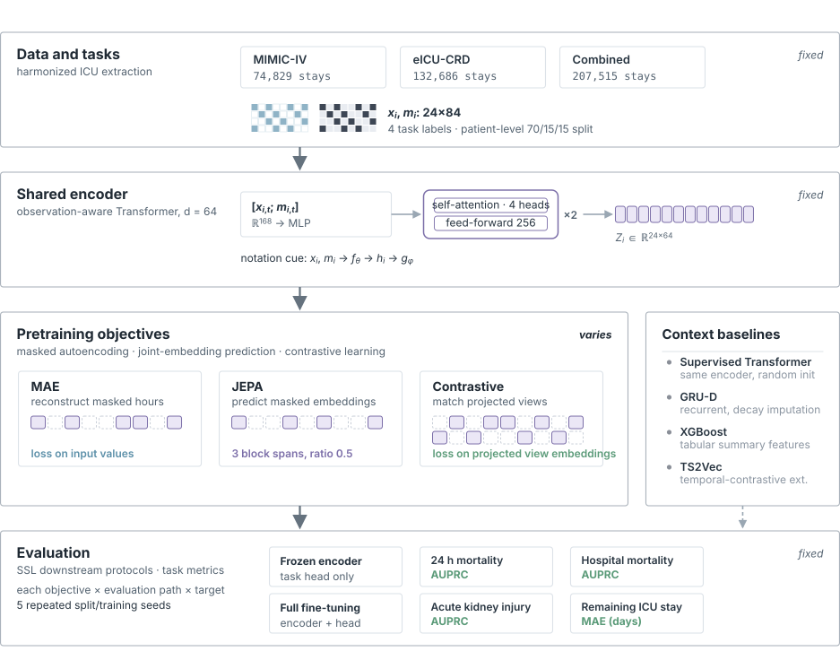
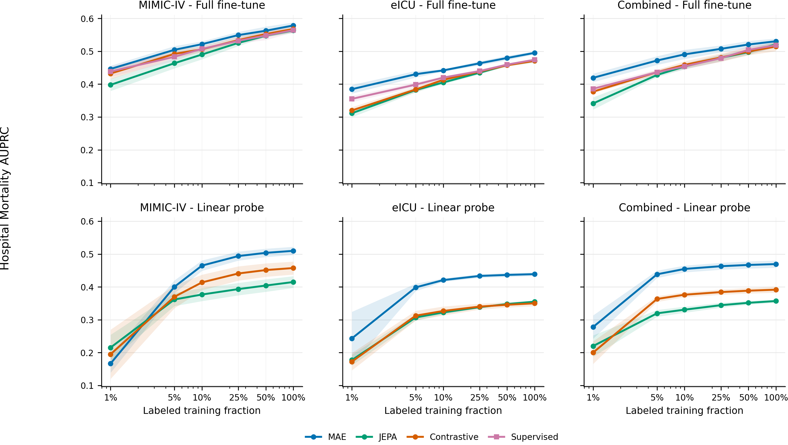

# SLICES: Self-Supervised Learning for Intensive Care Embeddings

<p align="center">
  
</p>

<p align="center">
  
  
  
  
</p>

<p align="center">
  <code>ICU time series</code> <code>self-supervised learning</code> <code>clinical AI</code> <code>PyTorch Lightning</code> <code>RICU</code> <code>Hydra</code>
</p>

**SLICES** is a benchmark and PyTorch codebase for comparing self-supervised
learning objectives on sparse, irregular ICU time series.

The core question is narrow by design: when the data pipeline, encoder,
tokenization, epoch/data-pass schedule, and downstream protocols are held fixed,
how do **MAE**, **JEPA**, and **contrastive learning** differ?

<p align="center">
  
</p>

## Status

- This branch contains the ML4H submission code, frozen aggregate results, and
  matching manuscript source.
- The frozen `slices-thesis-v1` export is projected into [results/](results/), with
  2,310 evaluated runs and a 420-run core comparison across 84 cells.
- Patient data and trained patient-data weights are not included. Clinical
  reproduction requires credentialed MIMIC-IV and eICU access.
- The result audit and synthetic CPU examples run without patient data or accounts.
- [RELEASE.json](RELEASE.json) identifies the packaged inputs;
  [MANIFEST.json](MANIFEST.json) pins every supplied file.

## What is included

| Area | Scope |
|---|---|
| Data pipeline | RICU extraction, hourly ICU tensors, observation masks, train-only normalization |
| Core SSL objectives | MAE, JEPA, contrastive |
| Extension objective | TS2Vec temporal contrastive learning |
| External reference | SMART/MART implementation, optional and outside the controlled thesis corpus |
| Encoders | Observation-aware Transformer, GRU-D, linear; SMART/MART as optional reference code |
| Downstream tasks | 24h mortality, hospital mortality, AKI KDIGO, remaining LOS |
| Protocols | Linear probing and full fine-tuning |
| Baselines | Supervised Transformer, GRU-D, XGBoost |
| Evaluation | AUROC, AUPRC, calibration, regression metrics, fairness summaries, descriptive paired comparisons |

SLICES is not a clinical deployment model, a public patient-data release, or a
replacement for broad ICU benchmarks such as YAIB. It is focused on objective
comparison under a shared sparse-clinical-time-series interface.

## Result snapshot

These results come from the frozen run-level aggregates in
[results/per_seed.csv](results/per_seed.csv). The audit recomputes them in
`audit-output/analysis.json`; [results/expected_analysis.json](results/expected_analysis.json)
contains the reference calculations.

- MAE has the highest five-seed mean AUPRC among the three core SSL methods in all
  nine linear-probe classification cells. Full fine-tuning compresses the observed
  differences and makes the supervised Transformer a stronger comparator.
- All method comparisons are descriptive. Five matched training seeds give an
  exact two-sided sign-flip paired-test floor of `p=0.0625`. Tasks sharing cohorts,
  split assignments, and pretrained encoders are not pooled as independent
  inferential units.
- LOS behaves differently from classification: contrastive has the lowest mean
  `test/mae` among the core SSL methods in all three frozen linear-probe LOS cells.
- Across the label-fraction grid, including the full-label cells, MAE has the best
  mean in `35/45` full-finetune cells against JEPA, contrastive, and supervised
  training, and in `37/45` linear-probe cells against JEPA and contrastive.

<p align="center">
  
</p>

The figure shows hospital mortality. The label-fraction counts above cover the
exported task grid; comparator sets differ between the two protocols.

## Install

Prerequisites:

- Python 3.12+
- [uv](https://github.com/astral-sh/uv)
- A Unix-like environment and internet or a dependency cache for installation
- R and authorized source ICU datasets only for clinical data extraction

Download and extract the repository ZIP, or check out this submission branch.
Run the following commands from the directory containing this README. The
artifact is self-contained; no sibling repository is required.

Audit the supplied files before changing or regenerating anything:

```bash
uv run --no-project python audit.py
```

Then install the locked environment, including the plotting dependencies:

```bash
uv sync --project framework --frozen --extra viz --python 3.12
```

## Quick start

### 1. Check the reported results

```bash
uv run --no-project python audit.py
```

The audit needs only the Python standard library. It checks file hashes, the core
comparison grid, five-seed sets, metric ranges, and the reported aggregate results.
It writes `audit-output/analysis.json`. Each source CSV row is a training run,
never a patient.

### 2. Run a synthetic CPU example

```bash
uv run --project framework python smoke.py
```

This exercises MAE, JEPA, contrastive, and the TS2Vec-style extension, checkpoint
transfer, and both downstream protocols. It uses one CPU thread and a 120-second
timeout. Synthetic metrics are software checks and do not enter the frozen results.

### 3. Add and evaluate an objective

```bash
uv run --project framework python extension.py --out extension-output
```

The complete TS2Vec-style example covers pretraining, shared encoder export,
linear probing, full fine-tuning, and validation-selected testing on synthetic
binary and regression tasks. See [EXTENDING.md](EXTENDING.md) for the interface and
[TS2VEC_CASE.md](TS2VEC_CASE.md) for the worked example and frozen extension results.

### 4. Reproduce the paper tables and figures

```bash
uv run --project framework python render.py --out paper/generated
```

This renders the numerical paper assets from the supplied CSVs. The matching
manuscript is in [paper/](paper/). To compile it, run the following from `paper/`
with `latexmk`, PDFLaTeX, and BibTeX installed:

```bash
latexmk -pdf -interaction=nonstopmode -halt-on-error main.tex
```

### 5. Reproduce clinical training with authorized data

[TRAINING.md](TRAINING.md) covers RICU extraction, processed tensors, historical
training settings, downstream adaptation, and baseline entry points. Start by
printing one explicit recipe from the repository root:

```bash
uv run --no-project python training_recipe.py --dataset miiv --objective mae --task mortality_hospital --seed 42 --protocol linear_probe
```

This prints commands without starting training. Follow the guide to run them from
`historical/`, using your own authorized data. The maintained implementation is in
`framework/`; the frozen launch source is in `historical/`.

See [REPRODUCIBILITY.md](REPRODUCIBILITY.md) for the full audit, diagnostic, and
reproduction guide. Clinical training has not been repeated for this package.

## Configuration

SLICES uses Hydra. Main config groups in [framework/configs/](framework/configs/):

| Group | Options |
|---|---|
| `ssl/` | `mae`, `jepa`, `contrastive`, `ts2vec`, `smart` |
| `model/` | `transformer`, `transformer_medium`, `transformer_large`, `gru_d`, `smart`, `linear` |
| `tasks/` | `mortality_24h`, `mortality_hospital`, `aki_kdigo`, `los_remaining` |
| `protocol/` | `linear_probe`, `full_finetune` |
| `data/` | `ricu` |

From `framework/`, inspect resolved configurations without starting training:

```bash
uv run python scripts/training/pretrain.py dataset=miiv ssl=mae --cfg job
uv run python scripts/training/pretrain.py dataset=eicu ssl=jepa --cfg job
uv run python scripts/training/pretrain.py dataset=miiv ssl=jepa ssl.mask_ratio=0.75 --cfg job
```

For historical result reproduction, use the explicit recipes in
[TRAINING.md](TRAINING.md) and the settings in
[results/scientific_configs.json](results/scientific_configs.json). Current
configuration defaults alone do not identify a historical experiment.

## Benchmark contract

The controlled comparison fixes:

- RICU-derived preprocessing
- 24h observation window
- patient-level splits
- train-only normalization
- normalize-then-zero-fill imputation
- separate observation masks
- observation-aware Transformer encoder
- downstream tasks and primary metrics
- five-seed evaluation where present

MAE, JEPA, and contrastive learning share the encoder interface and masking
budget. They do not use identical mask geometry: MAE uses random timestep masks,
JEPA uses block timestep masks, and contrastive learning uses two masked views.

The fixed scientific settings are recorded in [benchmark.json](benchmark.json).
Clinical rerun instructions are in [TRAINING.md](TRAINING.md), and public audit
paths are in [REPRODUCIBILITY.md](REPRODUCIBILITY.md).

## Repository layout

```text
SLICES/
+-- framework/                # Maintained implementation and locked environment
|   +-- configs/              # Hydra configs
|   +-- scripts/              # Preprocessing and training entry points
|   +-- src/slices/           # Data pipeline, models, training, evaluation
+-- historical/               # Source and configs from the frozen experiment launch
+-- results/                  # Frozen run-level metrics, configs, and diagnostics
+-- paper/                    # Matching manuscript, tables, figures, and diagrams
+-- docs/assets/              # README figures
+-- benchmark.json            # Fixed scientific contract
+-- audit.py                  # Standard-library result and file-integrity audit
+-- smoke.py                  # Synthetic objective and checkpoint checks
+-- extension.py              # Complete synthetic extension workflow
+-- render.py                 # Numerical paper asset renderer
+-- training_recipe.py        # Explicit credentialed training recipes
+-- REPRODUCIBILITY.md         # Detailed audit and reproduction guide
```

## Roadmap

- [x] Controlled MAE, JEPA, and contrastive SSL objectives.
- [x] RICU-based MIMIC-IV/eICU preprocessing pipeline.
- [x] Linear-probe and full-finetune downstream protocols.
- [x] Supervised Transformer, GRU-D, XGBoost, TS2Vec, and SMART implementations.
- [x] Fairness summaries and paired statistical export utilities.
- [x] Bundle frozen thesis metric export and provenance manifest.
- [ ] Add `CITATION.cff` after thesis/paper citation details are stable.
- [x] Add synthetic CPU examples for objective and checkpoint smoke tests.
- [x] Add a worked example for adding and evaluating a new SSL objective.
- [x] Package the paper tables and figures with a numerical result renderer.
- [ ] Add Docker or Apptainer environment for cluster reproduction.

## References

- Johnson et al. (2023), MIMIC-IV, *Scientific Data*.
- Pollard et al. (2018), eICU Collaborative Research Database, *Scientific Data*.
- Gygax et al. (2023), ricu, *GigaScience*.
- He et al. (2022), Masked Autoencoders, *CVPR*.
- Assran et al. (2023), I-JEPA, *CVPR*.
- Chen et al. (2020), SimCLR, *ICML*.
- Yu et al. (2024), SMART, *NeurIPS*.
- Yeche et al. (2024), YAIB, *ICLR*.

## License

SLICES is released under the MIT License. See [LICENSE](LICENSE). Bundled fonts
retain their separate license in [paper/diagrams/figma-conversion/](paper/diagrams/figma-conversion/).
Author identity is withheld for double-blind review.
